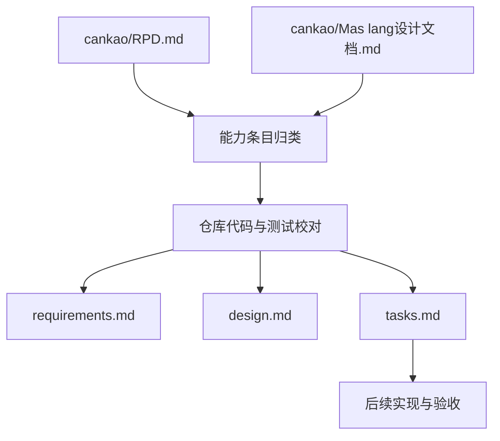

# 技术设计文档：Mas lang 语言路线图

## 1. 概述

- **问题陈述**：`cankao/RPD.md` 与 `cankao/Mas lang设计文档.md` 分别记录了阶段进度和语言蓝图，但两者长期分离，且 RPD 内部统计与细项状态存在冲突，导致团队无法直接据此判断真实交付边界。
- **当前状态**：仓库已经存在 `specs/` 脚手架示例，但没有承接 Mas lang 主路线图的规范目录。根据最新定位，`maslang` 是主力开发和未来发布的编译器，`compiler` 仅作为历史遗留实现保留，不再作为主路线图交付目标。代码层面已经可以确认 `maslang` 提供更完整的集合、数组、模板字符串与 LLVM 后端能力，`fama` 已实现 `new/build/run`，但当前仍连接遗留 `compiler`，模块系统、标准库和完整依赖管理仍未落地。

## 2. 技术方案

### 2.1 Why：为什么这样设计

- 采用“单一规范目录 + 三件套文档”的方式，可以把原先散落在参考目录中的规划、状态和后续任务统一到 `requirements.md`、`design.md`、`tasks.md` 中，满足规范驱动开发的可追溯要求。
- 迁移时不直接照抄 RPD 的阶段统计，而是以仓库实现和测试为准校对勾选状态，可以避免把已经过期的汇总百分比误当成事实。
- 保留“整体语言路线图”作为一个统一 feature，而不是立刻拆成多个子 feature，是因为当前两份参考文档本身就是跨编译器、包管理器和语言设计的总览文档，先聚合再细分更符合现状。
- 把 `maslang` 明确写成唯一主力编译器，可以避免后续任务仍被遗留 `compiler` 牵引，保证规范与发布方向一致。

### 2.2 How：如何实现

- **架构模式**：采用“规范先行 + 代码校对 + 状态矩阵”的文档架构。
- **模块划分**：用参考文档提供需求输入，用仓库代码提供完成状态校验，用 `specs/002-mascript-language-roadmap/` 作为新的单一输出目录。
- **数据流 / 控制流**：迁移流程先读取参考文档，再核对仓库实现，最后分别沉淀为需求、设计与任务。



### 2.3 What：落地对象

#### 组件与接口设计

| 组件 | 职责 | 当前状态 |
|------|------|------|
| `cankao/RPD.md` | 提供阶段化完成清单 | 已存在，但汇总统计不可靠 |
| `cankao/Mas lang设计文档.md` | 提供语言定位、模块与工具链蓝图 | 已存在，含较多未落地设计 |
| `specs/002-mascript-language-roadmap/requirements.md` | 以 EARS 语法表达语言与工具链需求 | 本次迁移创建 |
| `specs/002-mascript-language-roadmap/design.md` | 记录迁移原则、模块边界与技术取舍 | 本次迁移创建 |
| `specs/002-mascript-language-roadmap/tasks.md` | 维护可执行任务与完成状态 | 本次迁移创建 |

#### 数据模型 / API 设计

迁移过程以“能力状态记录”作为最小抽象单位：

```ts
interface CapabilityRecord {
  area: string;
  item: string;
  sourceDocs: string[];
  implementationScopes: string[];
  status: "done" | "todo";
  notes?: string;
}
```

状态判定规则如下：

1. `done`：仓库代码或测试可以直接定位到该能力，或参考文档细项状态与代码一致。
2. `todo`：仅存在于设计文档、RPD 未勾选，或存在明显冲突但无法在代码中确认。
3. `implementationScopes`：用于标识能力位于 `maslang`、`fama`、`compiler` 等哪个子项目，其中 `compiler` 仅作为遗留参考，不作为发布完成度的主要依据。

关键子项目职责如下：

| 子项目 | 角色 | 已确认能力 |
|------|------|------|
| `maslang` | 主力开发与未来发布的编译器 | list/map/array、模板字符串、安全转换、LLVM 代码生成 |
| `fama` | 项目骨架与 build/run CLI | `new`、`build`、`run`、基础模板写入，但仍需切换到主力编译器 |
| `compiler` | 历史遗留编译器实现 | 仅作旧实现参考，不作为发布目标 |
| `mascript-lang` | 编辑器扩展 | 代码片段与扩展入口 |
| `mascript-lsp` | 语言服务 | 本次未作为完成状态判断来源 |

## 3. 决策记录 (Trade-offs)

| 方案 | 优点 | 缺点 | 决策 |
|------|------|------|------|
| 把两份参考文档合并迁移到一个总路线图规范目录 | 统一入口、便于先建立追溯关系、适合当前总览型资料 | 文档范围较大，后续仍需按子系统拆分 | ✅ 采纳 |
| 按编译器、包管理器、标准库分别新建多个 spec | 结构更细、边界更纯粹 | 需要先重新拆解参考文档，当前信息粒度不够稳定 | ❌ 暂不采纳，后续可在总路线图基础上继续拆分 |
| 直接沿用 RPD 的完成率统计 | 迁移速度快 | 与细项勾选和仓库代码冲突，容易误导 | ❌ 放弃，原因：不能保证状态准确 |
| 以仓库代码与测试校对完成状态 | 状态更可靠，可定位实现来源 | 需要额外核查，迁移成本更高 | ✅ 采纳 |
| 继续把 `compiler` 与 `maslang` 并列视为主路线图核心 | 维护表面上更均衡 | 会偏离真实发布方向，并持续分散任务优先级 | ❌ 放弃，原因：不符合当前主力开发策略 |
| 以 `maslang` 作为唯一主力编译器来规划路线图 | 与真实开发优先级一致，便于后续收敛 `fama` 与语言特性 | 需要显式说明遗留 `compiler` 的非主线地位 | ✅ 采纳 |

## 4. 风险与待解决问题 (Open Questions)

- 风险：`fama build` 当前仍依赖遗留 `compiler`，而主力特性已经集中在 `maslang`；缓解措施：把 `fama` 切换到主力编译器列为高优先级任务。
- 风险：遗留 `compiler` 继续存在会让部分状态判断混入非主线实现；缓解措施：后续规范与任务默认只统计 `maslang` 发布链路，遗留实现仅作参考。
- 风险：`settings.toml` 已定义 `opt-level`，但代码中尚未看到该配置接入真实优化流程；缓解措施：保留为未完成任务，不在本次迁移中打勾。
- 待定：模块系统应优先在语法层、语义层还是包管理器层切入；需要确认方：语言/编译器维护者。
- 待定：标准库首批模块的最小 API 面应该如何定义；需要确认方：语言/运行时维护者。
- 待定：单行注释已存在，但多行注释是否纳入近期计划尚未定稿；需要确认方：语言设计者。


## 运行时内存管理补充（2026-09-17）

动态字符串、列表和字典采用非移动、暂停式标记清扫，默认自动回收；用户无需手动释放。编译器维护精确根槽，运行时在语句边界和循环头收集。固定数组保留值语义，其字符串元素参与追踪；列表和字典保留共享引用语义。原生字符串 ABI 不变，原生模块不得将借用托管指针保留到同步调用之后。实现、验收和限制见 `crates/maslang/docs/gc.md`。本补充不改变通用错误传播仍待实现的状态。
