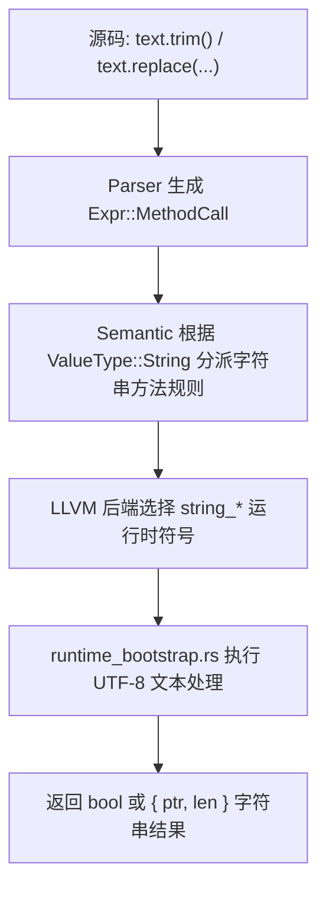

# 技术设计文档：字符串集合

## 1. 概述

- **问题陈述**：当前 `maslang` 已支持字符串字面量、拼接、模板字符串、相等比较与基础类型转换，但实例方法分派仍只覆盖 `list` 与 `map`。这导致路线图里的“字符串实例方法集合”长期停留在未完成状态，开发者无法用统一的点调用语法表达常见文本处理。
- **当前状态**：AST 已存在通用的 `Expr::MethodCall` 节点与 `MethodName` 枚举，语义分析中的 `infer_method_type` 仅对 `ValueType::List` 与 `ValueType::Map` 做分派，LLVM 后端和运行时也只声明了字符串拼接、比较与转换符号，没有字符串实例方法对应的 ABI。

## 2. 技术方案

### 2.1 Why：为什么这样设计

- 选择在现有 `Expr::MethodCall` 与 `MethodName` 上扩展字符串方法，而不是新增一套字符串专用 AST，可以把改动限制在解析、语义分派和后端调用三个明确节点，符合最小化修改原则。
- 首批只交付 `trim`、`contains`、`starts_with`、`ends_with`、`replace` 五个方法，是因为它们能覆盖“清洗 + 判断 + 替换”三类高频场景，同时不会像 `split`、字符索引那样立刻引入列表返回、Unicode 下标语义和更多边界条件。
- 继续复用现有 `{ ptr, len }` 字符串 ABI，可以让字符串返回值路径与拼接、转换、列表/字典字符串元素保持一致，避免在 LLVM 后端与运行时之间再维护第二套字符串表示。
- 布尔结果直接走现有 `bool` 表示，字符串结果继续走运行时返回 `ptr + out_len` 的模式，能让新增方法自然复用既有条件分支和打印逻辑。

### 2.2 How：如何实现

- **架构模式**：采用“复用现有方法调用 AST + 语义按目标类型分派 + 运行时符号扩展”的渐进式设计。
- **模块划分**：
  - `src/ast.rs`：扩展 `MethodName`，为字符串方法提供稳定枚举值与显示名称。
  - `src/parser.rs`：继续复用现有点调用解析流程，使字符串方法与列表/字典方法共享语法入口。
  - `src/semantic/containers.rs` 或拆出的字符串语义模块：新增 `ValueType::String` 的方法签名校验与返回类型推导。
  - `src/llvm_backend/expressions.rs`、`src/llvm_backend/runtime.rs`、`src/llvm_backend/mod.rs`：新增字符串方法运行时函数声明、调用封装与字符串结果重建逻辑。
  - `src/runtime_bootstrap.rs`：实现真实的字符串方法运行时函数，统一复用 UTF-8 文本解析与结果回写工具。
  - `src/semantic/tests.rs`、`src/llvm_backend/tests.rs`、`src/testdata/`：补充正反样例与 IR 级验证。
- **数据流 / 控制流**：源码中的字符串点调用先被解析为统一的 `MethodCall`，随后在语义阶段根据目标类型分派到字符串方法签名，再由 LLVM 后端绑定到具体运行时符号，最后由运行时基于 UTF-8 字符串完成实际操作。



### 2.3 What：落地对象

#### 组件与接口设计

建议复用现有方法名枚举，并为字符串方法增加以下成员：

```rust
enum MethodName {
    Append,
    Remove,
    Pop,
    Sort,
    Reverse,
    Index,
    Contains,
    Keys,
    Values,
    Trim,
    StartsWith,
    EndsWith,
    Replace,
}
```

语义层新增字符串方法分派入口，接口形态保持与现有容器方法一致：

```rust
fn infer_string_method_type(
    &mut self,
    method: MethodName,
    arguments: &[Expr],
    span: Span,
) -> Result<ValueType, CompilerError>
```

LLVM 后端新增字符串方法调用封装，避免在表达式编译逻辑里重复拼接 ABI 参数：

```rust
fn compile_string_method_call(
    &mut self,
    target: TypedValue<'ctx>,
    method: MethodName,
    arguments: &[Expr],
    span: Span,
) -> Result<TypedValue<'ctx>, CompilerError>
```

#### 数据模型 / API 设计

首批字符串方法集合与建议 ABI 如下：

| 方法 | Mas lang 签名 | 返回类型 | 运行时符号 | ABI 草案 |
|------|------|------|------|------|
| `trim` | `text.trim()` | `string` | `string_trim` | `(ptr, len, out_len_ptr) -> ptr` |
| `contains` | `text.contains(needle)` | `bool` | `string_contains` | `(ptr, len, needle_ptr, needle_len) -> u8` |
| `starts_with` | `text.starts_with(prefix)` | `bool` | `string_starts_with` | `(ptr, len, prefix_ptr, prefix_len) -> u8` |
| `ends_with` | `text.ends_with(suffix)` | `bool` | `string_ends_with` | `(ptr, len, suffix_ptr, suffix_len) -> u8` |
| `replace` | `text.replace(from, to)` | `string` | `string_replace` | `(ptr, len, from_ptr, from_len, to_ptr, to_len, out_len_ptr) -> ptr` |

关键行为约束：

1. `trim` 使用 UTF-8 文本语义处理首尾空白，返回新字符串。
2. `contains`、`starts_with`、`ends_with` 统一要求一个 `string` 参数，并返回布尔值。
3. `replace` 要求两个 `string` 参数；当 `from` 为空字符串时直接返回原字符串，避免不透明行为。
4. 新增运行时函数必须复用现有 `boxed_string_into_raw`、`string_as_str` 或等价 UTF-8 辅助函数，避免重复实现指针到文本的转换逻辑。

推荐的实现路径如下：

1. 解析层只负责识别方法名，不在语法阶段区分目标类型。
2. 语义层按 `ValueType::String` 做参数个数、参数类型与返回类型校验。
3. LLVM 后端为字符串参数拆出 `ptr/len`，对字符串结果继续走 `out_len + ptr` 重建，对布尔结果直接返回现有布尔值。
4. 运行时基于 Rust `str` / `String` API 完成实现，并统一维持 UTF-8 合法性。

## 3. 决策记录 (Trade-offs)

| 方案 | 优点 | 缺点 | 决策 |
|------|------|------|------|
| 在现有 `MethodName` 上扩展字符串方法 | 改动面小，解析链路复用充分，便于保持统一诊断风格 | 枚举会同时承载列表、字典和字符串方法 | ✅ 采纳 |
| 单独新增 `StringMethodName` 与专用 AST 节点 | 类型边界更纯粹 | 需要改 parser、AST、语义与后端的调用路径，改动更大 | ❌ 放弃，原因：不符合最小化改动原则 |
| 首批只支持 `trim/contains/starts_with/ends_with/replace` | 覆盖高频文本场景，返回类型简单，易于测试 | `split`、大小写转换等需求需要后续再扩展 | ✅ 采纳 |
| 首批就加入 `split`、字符索引与大小写转换 | 功能看起来更完整 | 会引入列表返回、Unicode 下标和更多 ABI 分支，显著扩大范围 | ❌ 放弃，原因：超出本次最小可交付范围 |
| 让字符串方法通过通用“反射式”运行时入口动态分派 | 运行时入口数量少 | LLVM 调用签名不稳定，类型安全与测试可读性差 | ❌ 放弃，原因：不利于静态类型编译器维护 |
| 为每个字符串方法声明独立运行时符号 | 类型清晰，IR 易于校验，便于逐个补测试 | 运行时符号数量增加 | ✅ 采纳 |

## 4. 风险与待解决问题 (Open Questions)

- 风险：`contains` 现有方法名已经用于列表与字典；缓解措施：继续通过目标值类型做语义分派，禁止在解析阶段硬编码容器类别。
- 风险：字符串返回值仍依赖 `ptr + out_len` ABI，若后端拼接参数顺序不一致，容易出现 Windows ABI 错误；缓解措施：为字符串方法单独封装后端调用辅助函数，并增加 IR 断言测试。
- 风险：`trim` 与 `replace` 涉及 UTF-8 文本处理，若运行时直接按字节截断会破坏中文字符串；缓解措施：运行时统一先转成 Rust `str`/`String` 后再操作。
- 风险：字符串方法增加后，错误诊断可能混入“列表/字典方法”文案；缓解措施：补充分类型错误消息，显式区分字符串目标、方法名与参数规则。
- 待定：后续是否需要增加 `len(string)` 内建支持或 `is_empty()` 方法；需要确认方：语言设计者。
- 待定：大小写转换是否要遵循 ASCII 规则还是 Unicode 规则；需要确认方：语言/运行时维护者。
