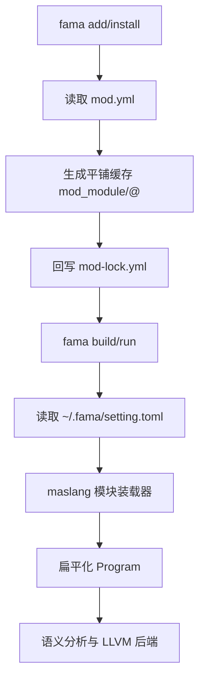

# 技术设计文档：模块导入与本地依赖安装

## 1. 概述

- **问题陈述**：当前 `fama` 只具备 `new/build/run` 基础能力，且 `build/run` 仍连接遗留 `compiler`；主力编译器 `maslang` 也仍停留在单文件编译阶段，尚不支持 `import`、本地依赖安装、`mod-lock.yml` 更新和 `mod_module` 平铺缓存。
- **当前状态**：项目骨架已经包含 `settings.toml`、`mod-lock.yml` 与 `mod_module/`，但这些文件除模板外没有真实行为。`maslang` 当前只接受单个 `SourceFile`，语义与 LLVM 后端都假定输入是已经展开好的一个顶层 `Program`。这意味着模块系统的最小落地点应放在“解析前装载模块并扁平化 AST”，而不是侵入现有后端主流程。

## 2. 技术方案

### 2.1 Why：为什么这样设计

- 选择在 `fama` 侧实现 `settings.toml` 与 `mod-lock.yml` 管理和依赖安装，而不是把依赖解析塞进编译器，是为了保持包管理和编译职责分离，避免 `maslang` 直接承担文件系统写操作。
- 选择“平铺缓存 + 冲突即失败”的依赖策略，而不是一次性实现完整的 pnpm 式多版本虚拟链接，是因为本次只支持本地路径源，先保证不出现嵌套依赖目录和不确定解析，比过早引入复杂链接模型更稳妥。
- 选择在主编译器前端新增模块装载器，把多个模块扁平化为单个 `Program` 再进入既有语义与 LLVM 后端，是因为这样能复用现有函数签名收集、作用域分析和代码生成路径，符合最小化改动原则。
- 选择实现 `pub` 与 `export import`，是因为如果只做 `import` 而不提供公开边界和聚合入口，`index.ms` 目录模块将无法成立，用户会被迫穿透内部文件结构。
- 选择把 `fama` 全局工具链设置收敛到 `~/.fama/setting.toml`，而不是继续沿用编译器私有路径，是为了让项目命令入口由 `fama` 统一控制，方便后续扩展更多工具链配置项。

### 2.2 How：如何实现

- **架构模式**：采用“`fama` 负责依赖元数据与安装，编译器负责只读模块解析与 AST 扁平化”的双层架构。
- **模块划分**：
  - `crates/fama/src/config.rs`：读取 `~/.fama/setting.toml`，解析全局编译器路径等设置。
  - `crates/fama/src/manifest.rs`：统一定义 项目 TOML 与 YAML 锁文件的结构、读写与校验。
  - `crates/fama/src/install.rs`：递归安装本地路径依赖，维护平铺缓存与锁文件。
  - `crates/fama/src/commands/add.rs`、`crates/fama/src/commands/install.rs`：暴露命令入口并复用 manifest/install 模块。
  - `crates/maslang/src/module_loader.rs`：解析入口文件、装载本地模块和已安装依赖、检测循环依赖，并产出扁平化后的 `Program`。
  - `crates/maslang/src/token.rs`、`lexer.rs`、`parser.rs`、`ast.rs`：补充 `import`、`pub`、`export import` 所需词法和语法结构。
  - `crates/fama/src/commands/build.rs`、`run.rs`：改为调用 `maslang` crate，并在编译前加载 `~/.fama/setting.toml`。
- **数据流 / 控制流**：
  1. `fama add` 读取目标依赖 `settings.toml`，把依赖写入当前项目 `settings.toml`。
  2. `fama install` 递归读取依赖图，按 `mod_module/<name>@<version>/` 创建平铺缓存，并回写 `mod-lock.yml`。
  3. `fama build/run` 读取项目 `settings.toml` 和 `~/.fama/setting.toml`，调用主力编译器。
  4. `maslang` 从入口文件开始装载模块，扁平化公开声明和重导出结果，最终再交给既有语义与 LLVM 后端。



### 2.3 What：落地对象

#### 组件与接口设计

`fama` 新增的 manifest 与锁文件模型：

```rust
#[derive(Debug, Clone, Serialize, Deserialize)]
struct ProjectManifest {
    name: String,
    version: String,
    #[serde(default)]
    dependencies: BTreeMap<String, DependencySpec>,
}

#[derive(Debug, Clone, Serialize, Deserialize)]
struct DependencySpec {
    path: String,
    version: String,
}

#[derive(Debug, Clone, Serialize, Deserialize)]
struct LockFile {
    #[serde(default)]
    dependencies: BTreeMap<String, LockedDependency>,
}

#[derive(Debug, Clone, Serialize, Deserialize)]
struct LockedDependency {
    version: String,
    source: LockedDependencySource,
    store_path: String,
}
```

`fama` 全局设置模型：

```rust
#[derive(Debug, Clone, Deserialize, Default)]
struct FamaSettingsFile {
    compiler: Option<CompilerSection>,
}

#[derive(Debug, Clone, Deserialize, Default)]
struct CompilerSection {
    binary: Option<String>,
}
```

编译器模块装载器核心接口：

```rust
pub fn analyze_module_graph(
    entry: &SourceFile,
    settings: &CompilerSettings,
) -> Result<FrontendOutput, CompilerError>
```

#### 数据模型 / API 设计

- `settings.toml` 约定：

```toml
[project]
name = "demo"
version = "0.1.0"

[dependencies]
math = { path = "../math-lib", version = "0.1.0" }
```

- `mod-lock.yml` 约定：

```yaml
dependencies:
  math:
    version: 0.1.0
    source:
      type: path
      path: ../math-lib
    store_path: mod_module/math@0.1.0
```

- 模块解析规则：
  - `src/main.ms` 为入口模块 `main`，不要求显式导入。
  - `src/utils/math.ms -> utils.math`
  - `src/utils/index.ms -> utils`
  - 依赖模块 `time.now` 解析到 `mod_module/time@1.0.0/src/now.ms` 或 `mod_module/time@1.0.0/src/now/index.ms`
  - `local.time` 强制解析到当前项目 `src/time.ms`
- 扁平化策略：
  - 装载器只把“当前模块可见声明”转换成最终 `Program`。
  - `import` 与 `export import` 在扁平化后不再进入语义分析和 LLVM 后端。
  - 为避免重复定义，装载器对每个模块仅装载一次，并按依赖拓扑顺序输出顶层声明。
- 冲突策略：
  - 同一安装过程若同名依赖出现不同版本或不同路径，则直接报错。
  - 同一模块中若导入别名与本地顶层声明重名，则直接报错。

## 3. 决策记录 (Trade-offs)

| 方案 | 优点 | 缺点 | 决策 |
|------|------|------|------|
| 平铺缓存 `mod_module/<name>@<version>`，冲突即失败 | 结构简单、无嵌套目录、实现成本低 | 暂不支持同名多版本共存 | ✅ 采纳 |
| 完整实现 pnpm 风格虚拟链接和多版本共存 | 能力更完整，更贴近长期目标 | 需要复杂链接、解析上下文与 Windows 特权处理 | ❌ 放弃，原因：超出本次最小可交付范围 |
| 在编译器前端新增模块装载器并扁平化 AST | 后端改动小，可复用现有语义和 LLVM 逻辑 | 诊断位置信息仍以扁平化源码上下文为主 | ✅ 采纳 |
| 让语义分析和 LLVM 后端原生理解模块边界 | 模块模型更纯粹 | 改动面广，容易破坏现有单文件编译 | ❌ 放弃，原因：不符合最小化改动原则 |
| `pub` + `export import` 支持目录聚合 | 能满足 `index.ms` 聚合入口设计 | 需要在装载器中增加公开符号表 | ✅ 采纳 |
| 所有顶层声明默认公开 | 实现最简单 | 无法提供库边界，也无法满足原始设计文档 | ❌ 放弃，原因：不满足模块公开控制要求 |

## 4. 风险与待解决问题 (Open Questions)

- 风险：模块装载器一旦错误地重复输出同一函数，会触发既有“函数重复定义”语义错误；缓解措施：为模块装载建立已访问集合，并对导入图做拓扑去重。
- 风险：`fama install` 需要复制目录，若直接整目录拷贝 `mod_module/` 会把旧缓存递归带入；缓解措施：复制依赖项目时显式忽略其自身 `mod_module/`、`build/` 与锁缓存目录。
- 风险：`~/.fama/setting.toml` 在不同系统上的 home 路径解析差异会导致找不到配置；缓解措施：统一通过环境变量解析 home 目录，并为缺失场景提供默认回退。
- 风险：当前 `SourceFile` 只支持单文件路径，扁平化后诊断会聚合到入口上下文；缓解措施：本次先保证错误文本清晰，后续再考虑多文件源码映射。
- 待定：后续 `git` 仓库依赖是否沿用同一锁文件结构，只增加 `source.type = git` 与提交哈希字段；需要确认方：包管理器维护者。
