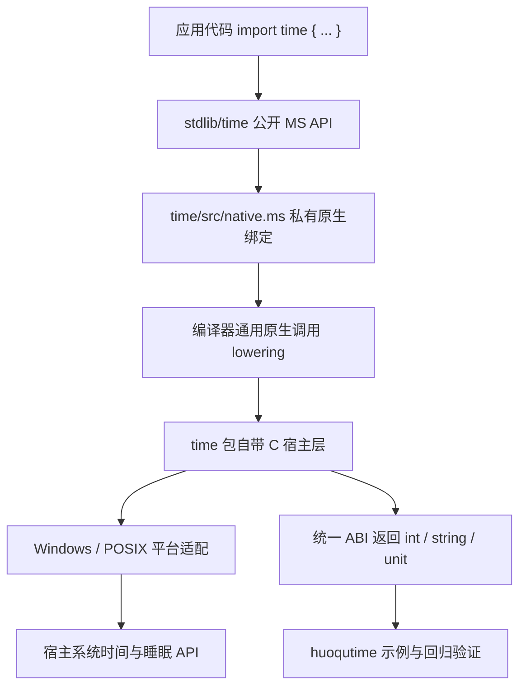

# 技术设计文档：time 标准库

## 1. 概述

- **问题陈述**：当前 `stdlib/time` 并不是独立标准库实现，而只是对 `__time_*` 内建函数的薄包装；这些符号被硬编码在 `maslang` 的语义分析、类型推导、LLVM 代码生成和 `runtime_bootstrap.rs` 中。这样做虽然能跑通当前功能，但每新增一个 time API 都必须修改编译器，违反“标准库演进不应反复改编译器业务分支”的边界。
- **当前状态**：
  - [system.ms](../../stdlib/time/src/system.ms#L1) 与 [timer.ms](../../stdlib/time/src/timer.ms#L1) 直接调用 `__time_*`，标准库层没有独立宿主实现。
  - `__time_*` 被列为保留内建名，直接出现在 [analysis.rs](../../crates/maslang/src/semantic/analysis.rs#L43)、[operations.rs](../../crates/maslang/src/semantic/operations.rs#L296) 与 [expressions.rs](../../crates/maslang/src/llvm_backend/expressions.rs#L321)。
  - 具体时间读取、RFC 格式化、单调时钟和睡眠逻辑都写在 [runtime_bootstrap.rs](../../crates/maslang/src/runtime_bootstrap.rs#L314) 里，由链接器把临时 `bootstrap.rs` 交给 `rustc` 参与最终链接，[linker.rs](../../crates/maslang/src/linker.rs#L75)。
  - 当前仓库没有现成的 Mas lang 原生 FFI 语法、标准库原生绑定约定或可复用的 C 宿主层构建流程。
  - 我已通过 Context7 查询 cppreference，确认标准 C 的 `<time.h>` 可以覆盖 `timespec_get(TIME_UTC)`、`gmtime/gmtime_r/gmtime_s` 与 `strftime` 这组“UTC 墙上时钟 + 时间格式化”能力；关于“单调时钟”和“阻塞睡眠”，标准 C 文档没有给出统一可移植接口，因此这里推断必须由 `time` 包自己的平台适配层承接，而不能依赖纯标准 C 一把梭。

## 2. 技术方案

### 2.1 Why：为什么这样设计

- 选择“通用原生绑定能力 + `time` 包自带 C 宿主层”，而不是继续扩展 `__time_*` 编译器内建，是为了把模块能力演进边界拉回标准库自身。编译器只需要知道“如何调用原生符号”，不需要知道“time 模块有哪些函数名”。
- 选择由 `stdlib/time` 自带 C 宿主层，而不是继续把宿主 API 写在 Rust `bootstrap.rs` 中，是为了避免未来新增 `now_local_offset()`、`parse_http_date()` 一类 time 扩展时再次修改编译器；理想状态下，后续只动 `stdlib/time` 即可。
- 选择“MS 包装层 + 私有原生绑定层 + C 宿主层 + 平台适配层”的四层结构，是为了把公开 API、ABI、宿主实现和平台差异拆开，避免跨平台逻辑直接污染对外模块。
- 选择继续保留 `int` 与 `string` 纯函数 API，而不是在本轮引入 `DateTime` 对象，是因为当前语言没有成熟的对象式日期类型系统；先把宿主接入边界做对，比在错误边界上继续扩 API 更重要。
- 选择用标准 C 承担 UTC 墙上时钟与 RFC/ISO 格式化、用平台适配承担单调时钟与睡眠，是因为前者可以依赖更稳定的 `<time.h>` 语义，后者在标准 C 层缺乏足够明确的可移植保证。

### 2.2 How：如何实现

- **总体架构**：采用“公开 MS API 层 + 私有原生绑定层 + C 宿主层 + 平台适配层 + 示例验证层”的五层结构。
- **模块划分**：
  - `stdlib/time/src/index.ms`：公开聚合入口，只导出对外稳定 API。
  - `stdlib/time/src/system.ms`：公开当前时间与格式化 API。
  - `stdlib/time/src/timer.ms`：公开单调计时与阻塞等待 API。
  - `stdlib/time/src/native.ms`：私有原生绑定声明层，只声明 `extern func` 或等价原生符号，不直接暴露给调用方。
  - `stdlib/time/native/include/*.h`：定义 `time` 包专用的 C ABI 头文件。
  - `stdlib/time/native/common/*.c`：实现 UTC 时间戳、RFC/ISO 格式化等公共逻辑。
  - `stdlib/time/native/platform/windows/*.c` 与 `.../posix/*.c`：分别实现单调时钟、睡眠，以及必要的 `gmtime_s/gmtime_r` 兼容封装。
  - `maslang`：只补最小“通用原生绑定”能力，不再硬编码 `time` 模块函数名。
  - `fama` / 编译链接链路：负责按包配置编译 C 源并参与最终链接。
- **编译器侧最小改动目标**：
  - 新增通用原生函数声明能力，例如 `extern func mas_time_now_unix() -> int` 这类最小语法或等价声明机制。
  - 通用原生调用仅支持 `int`、`float`、`bool`、`string`、`unit` 这组基础类型。
  - `string` 返回值使用统一原生 ABI，而不是为 `time` 专门保留单独 lowering 逻辑。
  - 语义分析、类型推导和代码生成中不再出现 `__time_now_unix`、`__time_sleep` 这类 time 专用枚举分支。
- **运行时/ABI 设计**：
  - 保留当前 Mas lang 公开 API 名称不变。
  - 引入与模块无关的通用原生字符串 ABI，例如：

```c
typedef struct {
    const unsigned char* ptr;
    unsigned long long len;
} MsString;
```

  - 编译器只认识通用 `MsString`、基础数值类型和 `void`；time 宿主层的 C 导出函数使用稳定符号名，例如：

```c
long long mas_time_now_unix(void);
long long mas_time_now_unix_millis(void);
MsString mas_time_now_iso8601(void);
MsString mas_time_now_rfc2822(void);
MsString mas_time_now_rfc7231(void);
long long mas_time_monotonic_millis(void);
void mas_time_sleep(long long ms);
```

  - `runtime_bootstrap.rs` 不再直接实现 time 逻辑，而是只保留通用运行时辅助能力，例如：
    - 原生模块返回 `string` 时所需的统一字符串构造/复制辅助函数。
    - 原生模块向 Mas lang 报告中文运行时错误时复用的统一 abort 辅助函数。
  - 这样后续任意标准库模块只要遵守通用 ABI，就能走同一套原生绑定路径，而不用再为每个模块单独加编译器分支。
- **C 宿主层实现原则**：
  - `now_unix()` / `now_unix_millis()`：优先用 `timespec_get(TIME_UTC)` 读取当前 UTC 秒与纳秒，再换算为秒级或毫秒级时间戳。
  - `now_iso8601()` / `now_rfc2822()` / `now_rfc7231()`：先把 UTC 时间拆成 `struct tm`，再使用固定格式模板输出，禁止依赖宿主本地时区与本地化月份/星期文本。
  - `monotonic_millis()`：不使用 `clock()` 充当单调时钟，改由平台适配层各自调用合适的单调时间源；这是基于标准 C 文档能力边界得出的实现推断。
  - `sleep(ms)`：不依赖标准 C 缺失的统一睡眠接口，改由平台适配层分别实现“至少等待指定毫秒数”的语义。
  - 负数睡眠、宿主时间读取失败、格式化失败等错误由 C 宿主层通过统一运行时错误辅助函数返回中文消息。
- **构建与链接路径**：
  - 在 `stdlib/time/settings.toml` 或等价包配置中新增原生源码清单与平台分发信息。
  - `fama build` / `maslang` 链路在编译项目依赖树时收集原生源码，按目标平台编译 C 产物，并与 LLVM 生成的对象文件、通用 `bootstrap.rs` 一起链接。
  - `time` 包自己的 C 产物参与链接，不再把时间实现复制进编译器生成的临时 Rust 文件。
- **数据流 / 控制流**：
  1. 应用工程 `import time { now_iso8601, monotonic_millis, sleep }`。
  2. `time` 公开函数调用 `native.ms` 里的私有原生绑定声明。
  3. 编译器把这些声明按“通用原生调用”规则 lowering 为对外部符号的调用。
  4. 链接器把 `stdlib/time` 自带的 C 宿主产物与主程序一并链接。
  5. C 宿主层返回统一 ABI 的 `int` / `string` / `void` 结果。
  6. `huoqutime` 示例验证导入、调用、格式化与跨平台适配链路。



### 2.3 What：落地对象

#### 公开 API

公开 API 保持不变：

```ms
pub func now_unix() -> int
pub func now_unix_millis() -> int
pub func now_iso8601() -> string
pub func now_rfc2822() -> string
pub func now_rfc7231() -> string
pub func monotonic_millis() -> int
pub func sleep(ms:int)
```

#### 私有原生绑定层

建议新增私有绑定文件：

```ms
extern func mas_time_now_unix() -> int
extern func mas_time_now_unix_millis() -> int
extern func mas_time_now_iso8601() -> string
extern func mas_time_now_rfc2822() -> string
extern func mas_time_now_rfc7231() -> string
extern func mas_time_monotonic_millis() -> int
extern func mas_time_sleep(ms:int)
```

`system.ms` 与 `timer.ms` 只调用这层声明，不再直接引用任何 `__time_*` 内建名。

#### 包级原生构建配置

建议在 `settings.toml` 增加等价配置，表达平台差异由包自己承接：

```toml
[native]
include = ["native/include"]

[native.sources]
common = ["native/common/time_common.c"]
windows = ["native/platform/windows/time_windows.c"]
posix = ["native/platform/posix/time_posix.c"]
```

#### 关键语义约束

1. `time` 标准库的公开 API 名称与返回类型不变。
2. 编译器只实现“通用原生绑定”能力，不再实现任何 time 专项语义分支。
3. `string` 原生返回值必须走统一 ABI 和统一所有权策略，避免 time 包自己发明第二套字符串协议。
4. `now_*` 一律基于 UTC 输出，`RFC 7231` 固定使用 `GMT` 文本。
5. `monotonic_millis()` 仅承诺同进程差值单调非负，不承诺与 Unix 时间戳可互换。
6. `sleep(ms)` 必须拒绝负数并返回中文错误。
7. 未来新增时间 API 时，允许只修改 `stdlib/time`，不再新增任何 `__time_*` 编译器代码。

## 3. 决策记录 (Trade-offs)

| 方案 | 优点 | 缺点 | 决策 |
|------|------|------|------|
| 继续沿用 `__time_*` 编译器内建并在 Rust bootstrap 中扩展 API | 当前实现最接近，短期改动最小 | 每次加时间能力都要改编译器，边界错误 | ❌ 放弃，原因：标准库能力不应继续业务耦合编译器 |
| 引入“通用原生绑定 + `time` 包自带 C 宿主层” | time API 后续演进只改标准库；编译器只保留通用机制；更符合跨平台封装 | 需要先补最小 FFI/原生链接能力 | ✅ 采纳 |
| 把 time 宿主层从 Rust bootstrap 挪到独立 Rust crate | 仍可复用现有 Rust 能力 | 本质上仍让标准库演进依赖编译器构建链路，且第三方依赖处理更复杂 | ❌ 放弃，原因：没有解决“time 专项逻辑留在编译器侧”的根问题 |
| 纯 Mas lang 层自己拼接 Unix 时间与 RFC 字符串 | 编译器改动最少 | 无法独立读取系统时间，日期换算与 RFC 格式化复杂且易错 | ❌ 放弃，原因：宿主能力缺失，且实现风险高 |
| 墙上时钟使用标准 C，单调时钟与睡眠走平台适配层 | 公开语义稳定，跨平台边界清晰 | 需要维护 Windows / POSIX 两套适配 | ✅ 采纳 |
| 把 `clock()` 直接当成单调时钟统一实现 | 表面简单 | 标准语义不足，容易混淆 CPU 时间与真实耗时 | ❌ 放弃，原因：不满足计时器语义稳定性 |

## 4. 风险与待解决问题 (Open Questions)

- 风险：当前仓库没有现成的 Mas lang 原生 FFI 语法与包级原生构建约定；缓解措施：先把“通用原生绑定最小能力”作为明确前置任务，不把它继续伪装成 time 私有逻辑。
- 风险：原生 `string` 返回值的内存所有权如果不先定义清楚，后续所有标准库模块都会重复踩坑；缓解措施：把统一字符串 ABI 和运行时辅助函数纳入通用能力设计，而不是让 `time` 私下约定。
- 风险：标准 C 只足够覆盖 UTC 墙上时钟和格式化，`monotonic_millis()` 与 `sleep(ms)` 需要平台适配；缓解措施：把平台差异限制在 `stdlib/time/native/platform/*`，不把分支散落进编译器。
- 风险：当前链接链路只负责“LLVM 对象 + Rust bootstrap”，没有原生 C 编译步骤；缓解措施：由 `fama` / 链接器补充统一的源码收集、平台筛选和链接流程，并在规格中单列验证任务。
- 风险：如果迁移期仍保留 `__time_*` 隐式可用，调用方会继续绕过标准库边界；缓解措施：迁移完成后删除 time 专项内建并补充“直接调用旧符号应失败”的回归验证。
- 待定：`通用原生绑定能力` 是否需要单独抽成新的规格编号，还是先作为 `005-time-standard-library` 的前置子域实现；需要确认方：语言/构建链路维护者。
- 待定：包级原生构建配置最终放在 `settings.toml` 还是 `mod.yml` 更符合现有工具链职责；需要确认方：`fama` 维护者。
