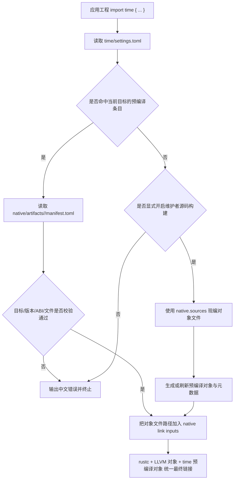

# 技术设计文档：time 预编译原生产物分发

## 1. 概述

- **问题陈述**：当前 `stdlib/time` 已经从 time 专项编译器内建迁移为“MS 包装层 + 原生绑定 + C 宿主层”，但消费侧仍然依赖构建时现编 C 源文件。只要调用方机器缺少本机 C 工具链，`time` 作为普通依赖就可能无法通过构建，这与“标准库依赖应当尽量像普通包一样被直接消费”的目标冲突。
- **当前状态**：
  - [stdlib/time/settings.toml](../../stdlib/time/settings.toml) 只声明了 `native/include` 与 `native.sources`，没有任何预编译产物入口。
  - [crates/maslang/src/linker.rs](../../crates/maslang/src/linker.rs) 在 `compile_native_objects()` 中对所有包一律调用 `cc::Build` 编译中间对象文件，然后再把这些对象文件作为 `rustc` 的 `link-arg` 参与最终链接。
  - [crates/fama/src/install.rs](../../crates/fama/src/install.rs) 会复制依赖目录树，但显式跳过 `build`、`target`、`mod_module`、`.git`；这意味着如果预编译产物落在包目录内的稳定路径，例如 `native/artifacts/`，它们可以随依赖一起进入 `mod_module/` 缓存。
  - 当前默认目标三元组仍是 `x86_64-pc-windows-msvc`，因此“没有 `gcc`”的表面问题，本质上应该抽象为“普通调用方不应被要求具备任何本机 C 编译器，包括 `gcc`、`clang`、`cl.exe`”。

## 2. 技术方案

### 2.1 Why：为什么这样设计

- 选择“包内预编译对象文件分发 + 链接器按目标选择”的方案，是为了把“需要本机 C 编译器”的责任从依赖消费侧移回标准库维护侧和发布侧。普通开发者拿到的应当是可直接链接的结果，而不是一套等待本地现编的 C 源。
- 选择把预编译产物放在 `time` 包目录里，而不是放到外部缓存、网络下载或临时构建目录，是为了复用现有 `fama install` 的目录复制模型，尽量减少新的分发基础设施。
- 选择继续保留 `native.sources`，但把源码编译路径收敛为“显式维护者模式”，是为了不丢掉 C 宿主层的可维护性和可再生能力，同时避免普通 `build/run` 自动触发隐式源码编译。
- 选择预编译“对象文件清单”而不是动态库，是为了复用当前 `rustc -C link-arg=<object>` 的最终链接方式，避免引入运行时动态库查找、装载路径和发布包额外部署问题。
- 选择在预编译产物旁边引入目标元数据与源码指纹，是为了防止包源码更新后仍误链接陈旧对象文件，保证“可重建”和“可追溯”。
- 没有选择“把 time 宿主层迁回 Rust”或“在用户机构建时自动下载编译器”，是因为这两种做法分别违背了“继续走 C 宿主层”与“最小化分发复杂度”的约束。

### 2.2 How：如何实现

- **架构模式**：采用“公开 API 不变 + 包级预编译产物层 + 链接器目标解析层 + 维护者产物刷新层”的分层架构。
- **模块划分**：
  - `stdlib/time/src/*.ms`：保持公开 API 不变，不承载本规格的行为变化。
  - `stdlib/time/native/include/` 与 `native/**/*.c`：继续作为唯一源码来源，只供维护者刷新预编译产物时使用。
  - `stdlib/time/native/artifacts/<target-triple>/`：存放对应目标的预编译对象文件与元数据，保证可随包分发。
  - `stdlib/time/settings.toml`：新增预编译目标声明、ABI 版本、源码回退策略等配置。
  - `crates/maslang/src/linker.rs`：把“原生输入收集”从“无条件源码编译”改成“预编译优先，显式源码回退次之，否则报错”。
  - `fama install`：原则上不增加新打包机制，只通过回归验证保证 `native/artifacts/` 不会被依赖安装流程过滤掉。
  - 维护者产物刷新脚本或 CI：面向维护者提供“从 C 源生成各目标对象文件与元数据”的专用流程。
- **链接输入解析策略**：
  1. 编译器按现有模块图收集包根目录。
  2. 对每个包读取 `settings.toml` 中的 `native` 段。
  3. 若当前目标三元组命中 `native.prebuilt` 声明，则读取对应元数据并校验对象文件存在性、包版本、ABI 版本、源码指纹。
  4. 若校验通过，直接把对象文件路径加入 `native_objects`，不执行 `cc::Build`。
  5. 若未命中预编译产物，且当前构建显式开启维护者源码构建模式，则回退到 `native.sources` 现编流程。
  6. 若既无预编译产物又未开启维护者模式，则在进入最终链接前以中文错误终止。
- **维护者源码构建策略**：
  - 维护者模式需要显式开关，例如 `fama build --allow-native-source-build` 或等价低层编译选项，不允许普通依赖消费路径默认启用。
  - 维护者模式的职责是“从源码生成对象文件与元数据，再回写到包目录”，而不是成为普通用户的隐式兜底。
  - 产物刷新完成后，包目录中应该具备下一次普通消费所需的全部对象文件与元数据。
- **包目录约定**：
  - 不把预编译产物放在 `build/` 或 `target/` 下，因为这些目录会被 [crates/fama/src/install.rs](../../crates/fama/src/install.rs) 的依赖复制逻辑跳过。
  - 统一放在 `native/artifacts/<target-triple>/`，使本地路径依赖、平铺缓存与未来发布包都能使用同一路径协议。
- **目标支持策略**：
  - 初始强制支持当前默认目标 `x86_64-pc-windows-msvc`。
  - 预留同构的 POSIX 目标条目，例如 `x86_64-unknown-linux-gnu`，但由支持矩阵逐步增加，不要求本规格一次性把所有目标都做满。
  - 目标必须精确匹配，不允许拿 Windows 对象文件去链接 POSIX，也不允许在不同 ABI 版本间混用。
- **数据流 / 控制流**：



### 2.3 What：落地对象

#### 配置与数据模型设计

建议扩展 `stdlib/time/settings.toml`，在保留现有源码声明的同时补齐预编译分发表达能力：

```toml
[native]
abi = 1
source_fallback = "explicit"
include = ["native/include"]

[native.sources]
common = ["native/common/time_common.c"]
windows = ["native/platform/windows/time_windows.c"]
posix = ["native/platform/posix/time_posix.c"]

[native.prebuilt.x86_64-pc-windows-msvc]
manifest = "native/artifacts/x86_64-pc-windows-msvc/manifest.toml"
objects = [
  "native/artifacts/x86_64-pc-windows-msvc/time_common.obj",
  "native/artifacts/x86_64-pc-windows-msvc/time_windows.obj",
]

[native.prebuilt.x86_64-unknown-linux-gnu]
manifest = "native/artifacts/x86_64-unknown-linux-gnu/manifest.toml"
objects = [
  "native/artifacts/x86_64-unknown-linux-gnu/time_common.o",
  "native/artifacts/x86_64-unknown-linux-gnu/time_posix.o",
]
```

对应元数据文件建议采用 `manifest.toml`，至少覆盖以下字段：

```toml
package = "time"
package_version = "0.1.0"
target = "x86_64-pc-windows-msvc"
abi = 1
source_hash = "sha256:..."
header_hash = "sha256:..."
objects = [
  "time_common.obj",
  "time_windows.obj",
]
```

#### 链接器内部接口设计

建议把现有“只返回源码编译结果”的逻辑提升为统一的原生链接输入解析器：

```rust
enum NativeSourceFallback {
    Never,
    Explicit,
}

struct NativePrebuiltTarget {
    manifest: String,
    objects: Vec<String>,
}

struct NativeBuildConfig {
    abi: u32,
    include_dirs: Vec<PathBuf>,
    source_files: Vec<PathBuf>,
    source_fallback: NativeSourceFallback,
    prebuilt: BTreeMap<String, NativePrebuiltTarget>,
}

struct NativeLinkInputs {
    objects: Vec<PathBuf>,
    resolved_from_prebuilt: bool,
}
```

核心流程不再是 `compile_native_objects()` 单一路径，而应抽象为：

```rust
fn resolve_native_link_inputs(
    package_roots: &[PathBuf],
    native_root: &Path,
    source: &SourceFile,
    allow_native_source_build: bool,
) -> Result<Vec<PathBuf>, CompilerError>
```

其职责是：

1. 优先解析 `native.prebuilt.<target>`。
2. 校验 `manifest.toml` 与对象文件。
3. 仅在 `allow_native_source_build == true` 且配置允许时回退到源码编译。
4. 统一生成中文错误，避免把“缺少预编译产物”误报成“找不到 gcc”。

#### 维护者产物刷新接口

本规格不限定最终脚本语言，但要求提供一条清晰、可重复的维护者流程，最小职责如下：

```text
输入：
- 目标三元组
- time 包根目录
- C 源文件清单
- ABI 版本

输出：
- native/artifacts/<target>/ 下的对象文件
- 对应 manifest.toml
- 与源码/头文件一致的摘要字段
```

建议维护者流程具备以下行为：

1. 只在显式调用时运行。
2. 产物路径稳定，便于提交到仓库或进入发布包。
3. 刷新后可立刻被普通 `fama install` + `fama build` 消费。

## 3. 决策记录 (Trade-offs)

| 方案 | 优点 | 缺点 | 决策 |
|------|------|------|------|
| 继续沿用“构建时现编 C 源文件” | 实现最接近当前主线，短期改动小 | 普通调用方仍依赖本机 C 工具链，无法解决“无 gcc/clang/cl.exe”消费痛点 | ❌ 放弃，原因：核心问题就是消费侧不应再背负源码编译前提 |
| 包内分发预编译对象文件，链接器按目标优先消费 | 普通用户无需本机 C 编译器；复用现有最终链接方式；符合当前 `fama install` 目录复制模型 | 需要维护目标矩阵与产物刷新流程；仓库会引入少量二进制文件 | ✅ 采纳 |
| 在构建时动态下载预编译产物 | 调用方理论上也可无编译器使用 | 需要新增网络分发、缓存、校验与离线策略，复杂度明显更高 | ❌ 放弃，原因：超出当前工具链能力边界，且不符合最小化原则 |
| 把 time 宿主层改回 Rust 实现 | 可以复用当前 Rust 工具链 | 偏离“Mas lang 链接 C 宿主层”的设计方向，也无法复用到后续其他 C 原生模块 | ❌ 放弃，原因：不符合本规格前置约束 |
| 为用户机内置或捆绑编译器 | 保留源码即构建模型 | 分发体积大、平台维护成本高、用户环境复杂度更高 | ❌ 放弃，原因：把问题从“依赖编译器”变成“分发编译器”，收益不成比例 |
| 缺失预编译产物时自动回退源码编译 | 某些环境下更“自动” | 会重新把本机 C 工具链要求暴露给普通调用方，违背无编译器消费目标 | ❌ 放弃，原因：必须把源码编译收敛到显式维护者路径 |

## 4. 风险与待解决问题 (Open Questions)

- 风险：预编译对象文件可能与最新 `native/*.c` 或头文件不一致；缓解措施：在 `manifest.toml` 中记录源码与头文件摘要，并在链接前校验。
- 风险：仓库体积会因为引入对象文件而增长；缓解措施：初期只覆盖当前默认目标，采用对象文件最小集合，不把中间日志、临时文件或重复产物纳入仓库。
- 风险：支持矩阵逐步扩展后，维护者需要更多平台构建环境；缓解措施：把产物刷新流程收敛为脚本或 CI 作业，避免手工零散产物。
- 风险：如果仍把错误暴露成底层编译器缺失，用户会误以为必须自行安装 `gcc`；缓解措施：把缺失预编译产物和未开启维护者模式单独映射成中文诊断。
- 风险：`fama install` 当前只验证依赖目录是否具备 `settings.toml` 和 `src/`，没有专门验证预编译产物是否完整；缓解措施：在实施任务中补充依赖复制回归用例和链接前校验。
- 待定：维护者源码构建入口最终落在 `fama build` 参数、单独脚本，还是两者并存；需要确认方：语言工具链维护者。
- 待定：预编译产物是否需要额外记录编译器品牌/版本用于审计；需要确认方：标准库维护者。
- 待定：未来若 `time` 之外的其他标准库模块也引入 C 宿主层，`native.prebuilt` 是否直接抽象为通用包级协议；需要确认方：编译器与包管理维护者。
