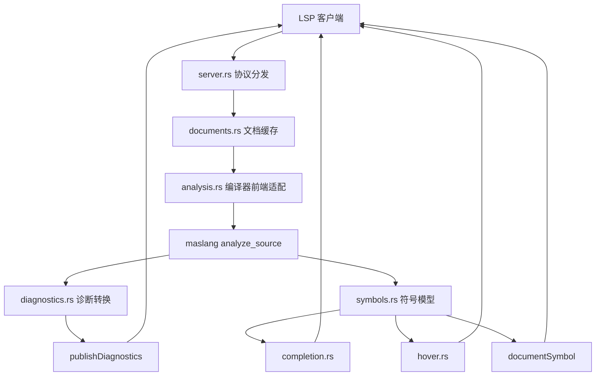

# 技术设计文档：mas-lang LSP 语言服务器

## 1. 概述

- **问题陈述**：`mascript-lsp` 当前只有默认 `Hello, world!` 入口，无法作为编辑器语言服务器使用。语言对外名称已调整为 `mas-lang`，它是编译型静态类型语言，不再使用带 `script` 的产品命名；真实语言规则仍集中在当前代码目录 `maslang`，如果 LSP 单独实现词法、语法和语义，会产生维护成本和规则漂移。
- **当前状态**：`crates/maslang/src/lib.rs` 已暴露 `analyze_source`、`FrontendOutput`、`CompileOptions` 和 `load_settings`；`diagnostic.rs` 提供 `CompilerError`、`ErrorStage`、`MessageId` 与中文渲染；`source.rs` 提供 `SourceFile`、`Span` 与行列换算。`mascript-lsp` 尚未声明依赖、协议层、文档缓存或测试。

## 2. 技术方案

### 2.1 Why：为什么这样设计

- 采用 `tower-lsp` 是因为它直接提供 Rust LSP 服务入口、`LanguageServer` trait、`LspService` 和 stdio `Server`，能让项目聚焦 mas-lang 语言能力，而不是手写 JSON-RPC 协议层。
- LSP 复用 `maslang` 前端，是为了让编辑器诊断与构建诊断保持同源，避免 LSP 与编译器分别维护关键字、类型系统、模块导入和语义规则。
- 第一阶段只承诺文本同步、诊断、补全、悬停和文档符号，是因为这些能力能构成最小可用语言服务器；定义跳转、引用查找、重命名和格式化需要更完整的工作区符号索引，应在基础索引稳定后迭代。
- 将 LSP 拆成协议层、文档仓库、分析适配层、能力服务和转换层，可以避免把所有逻辑堆入 `main.rs`，也方便后续独立测试。

### 2.2 How：如何实现

- **架构模式**：事件驱动的 LSP 后端 + 共享编译器前端适配层。
- **模块划分**：
  - `main.rs`：只负责启动 tokio runtime、创建 `LspService` 和 stdio server。
  - `server.rs`：实现 `tower_lsp::LanguageServer`，分发 LSP 生命周期和 textDocument 请求。
  - `documents.rs`：维护打开文档的 URI、版本、路径和文本。
  - `analysis.rs`：把文档内容转换为 `SourceFile`，调用 `maslang` 前端，并保存诊断、符号和补全所需的分析结果。
  - `diagnostics.rs`：负责 `CompilerError` 到 LSP `Diagnostic` 的转换。
  - `symbols.rs`：从 AST 或降级词法扫描结果生成文档符号、悬停和补全所需的符号模型。
  - `completion.rs`：组合关键字、基础类型、内建函数和当前作用域符号补全。
  - `hover.rs`：根据光标位置和符号模型生成悬停内容。
  - `lsp_convert.rs`：集中处理 mas-lang `Span` 与 LSP `Position`、`Range` 的转换。
  - `tests/` 或模块内测试：覆盖协议无关的文档缓存、诊断转换、符号提取和补全逻辑。
- **源码身份约束**：模块展开后的 AST 和内部符号名仅用于语义分析与代码生成。LSP 从当前内存文档的原始 AST 提取补全、悬停和文档符号；编译器记录模块源码偏移及名称映射，返回语义错误前还原原文件位置和用户名称。依赖文件错误通过 LSP relatedInformation 指向实际文件，入口文档不使用依赖文件的字节偏移。
- **数据流 / 控制流**：客户端打开或修改文档后，服务端更新缓存、执行分析、发布诊断；请求型能力读取最近一次分析快照，不在每次请求里重复完整分析。



### 2.3 What：落地对象

#### 组件与接口设计

```rust
/// 保存一份已打开文档的编辑器状态。
pub struct OpenDocument {
    pub uri: Url,
    pub version: i32,
    pub path: PathBuf,
    pub text: String,
}

/// 封装单个文档的最新分析结果，供诊断、补全和悬停复用。
pub struct DocumentAnalysis {
    pub diagnostics: Vec<Diagnostic>,
    pub symbols: Vec<MasSymbol>,
    pub tokens_available: bool,
}

/// 提供协议无关的文档分析入口，避免 LSP handler 直接依赖编译器细节。
pub trait AnalysisService {
    fn analyze_document(&self, document: &OpenDocument) -> DocumentAnalysis;
}
```

#### 数据模型 / API 设计

| 模型 | 字段 | 用途 |
|------|------|------|
| `OpenDocument` | `uri`、`version`、`path`、`text` | 保存编辑器中的当前文档内容 |
| `DocumentAnalysis` | `diagnostics`、`symbols`、`tokens_available` | 保存最近一次分析快照 |
| `MasSymbol` | `name`、`kind`、`range`、`selection_range`、`detail` | 支撑文档符号、补全和悬停 |
| `WorkspaceContext` | `root_uri`、`root_path`、`settings` | 处理单文件模式与工作区模式差异 |

初始 LSP 能力声明：

| LSP 能力 | 首批状态 | 数据来源 |
|----------|----------|----------|
| `textDocumentSync` | 实现 | `documents.rs` |
| `publishDiagnostics` | 实现 | `analysis.rs` + `diagnostics.rs` |
| `completionProvider` | 实现 | `completion.rs` + `symbols.rs` |
| `hoverProvider` | 实现 | `hover.rs` + `symbols.rs` |
| `documentSymbolProvider` | 实现 | `symbols.rs` |
| `definitionProvider` | 已声明 | 2026-09-21 新增当前文件结构体/字段跳转；跨文件工作区索引仍待实现 |
| `referencesProvider` | 暂不声明 | 后续工作区索引 |
| `renameProvider` | 暂不声明 | 后续引用分析 |
| `documentFormattingProvider` | 暂不声明 | 后续格式化规范 |

#### 编译器共享接口需求

首批优先直接复用现有接口：

1. `SourceFile::new(path, text)` 构造 LSP 文档对应的源码。
2. `load_settings()` 读取编译器设置，缺省使用中文诊断。
3. `analyze_source(&source, &settings)` 执行模块装载、语法和语义分析。
4. `CompilerError` 中的 `stage`、`message_id`、`args`、`span` 用于生成 LSP 诊断。

如果实现补全、悬停和文档符号时发现 AST 缺少必要的 `Span`，应优先在 `maslang` 追加小型共享字段或查询接口，并同步编译器测试；不要在 LSP 中通过字符串猜测完整语义。

四阶段审查结论：

1. `Program`、`Stmt`、`Parameter`、`ImportPath`、`ImportItem`、`TypeName` 已覆盖文档符号所需的声明级源码跨度，成功分析路径不需要新增编译器共享接口。
2. 模块装载会把当前文件函数名重写为内部全局名，LSP 展示层需要从原始源码声明片段恢复用户书写的函数名，避免向编辑器暴露内部重写名称。
3. 语法错误或缺失依赖导致完整前端失败时，LSP 可复用编译器 `Lexer` 做降级扫描；该扫描只识别已经完整书写的导入、函数、变量和常量声明，不承担完整语义判断。
4. 首批补全和悬停不新增语义类型查询接口：补全来自静态关键字、基础类型、内建函数和 `MasSymbol`；悬停来自 `MasSymbol.detail`。后续若要展示表达式推断类型，再在编译器语义层暴露只读查询接口。

## 3. 决策记录 (Trade-offs)

| 方案 | 优点 | 缺点 | 决策 |
|------|------|------|------|
| 使用 `tower-lsp` 实现协议层 | Rust 生态成熟，支持 stdio server、能力声明和 textDocument handler，示例与 LSP 类型齐全 | 需要引入 tokio 与 tower-lsp 依赖 | ✅ 采纳 |
| 手写 JSON-RPC 和 LSP 消息循环 | 依赖少，可完全控制协议细节 | 容易出协议兼容问题，维护成本高 | ❌ 放弃，原因：当前目标是语言能力，不是协议框架 |
| LSP 复用 `maslang` 前端 | 诊断与构建同源，减少规则漂移 | 编译器接口可能需要补充位置和符号信息 | ✅ 采纳 |
| LSP 重新实现轻量 parser | 补全可局部容错，短期可能更灵活 | 会形成第二套语言规则，长期不可维护 | ❌ 放弃，原因：违反主力编译器单一事实源 |
| 首批实现跳转、引用和重命名 | 编辑器能力更完整 | 需要跨文件符号索引和引用模型，容易扩大范围 | ❌ 暂不采纳，原因：先交付最小可用 LSP |
| 先实现诊断、补全、悬停、文档符号 | 范围可控，能验证协议、缓存、编译器复用和基础符号模型 | 导航类能力需要后续迭代 | ✅ 采纳 |

## 4. 风险与待解决问题 (Open Questions)

- 风险：`analyze_source` 当前包含模块装载，编辑器中的未保存依赖文件可能与磁盘内容不同；缓解措施：首批仅保证当前打开文档内容实时，跨文件未保存同步列入后续任务。
- 风险：编译器 AST 或语义结果可能缺少符号级源码跨度，影响悬停和文档符号精度；缓解措施：实现前先审查 AST span 覆盖，必要时在编译器前端补最小共享字段。
- 风险：完整重分析在大文件中可能超过 500ms；缓解措施：首批记录耗时并保持接口可替换，后续再做增量词法或局部分析。
- 风险：LSP stdout 混入调试输出会破坏协议；缓解措施：所有日志使用客户端 `logMessage`、stderr 或显式日志文件。
- 待定：mas-lang VS Code 扩展位于 `mas-lang-vscode` 还是其他目录作为默认接入点；需要确认方：编辑器插件维护者。
- 待定：补全项是否要包含标准库包与 `fama` 依赖缓存中的导出符号；需要确认方：语言与包管理维护者。
- 待定：是否把 `maslang` 提升为 workspace 依赖或通过 path dependency 独立引用；需要确认方：仓库构建维护者。
