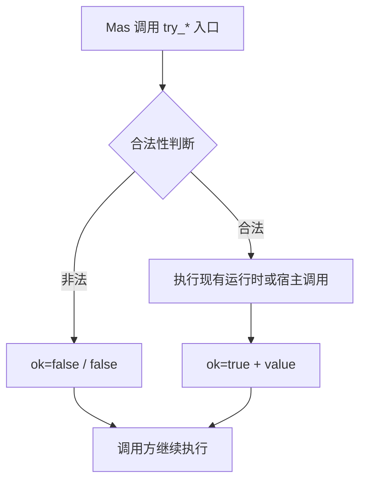

# 技术设计文档：可恢复运行时错误

## 1. 概述

- **问题陈述**：Mas lang 的若干运行时失败（浮点排序比较器、标准输出 I/O、time 宿主失败、容器越界/缺键、整数溢出/除零、安全转换的非法 UTF-8）会直接终止进程，调用方无法判断失败并继续。
- **当前状态**：严格接口通过 `abort_runtime`/`mas_numeric_error` 输出中文错误并以状态码 1 退出；安全转换已有 `try_int`/`try_float`/`try_bool` 与内部结果类型 `try_result<T>`（`.ok` / `.value`）。time 标准库以 C 宿主层 + 预编译产物分发，失败路径直接 `mas_runtime_abort`。

## 2. 技术方案

### 2.1 Why：为什么这样设计

- **复用既有结果表示**：`try_result<T>` 已有语义、诊断名称（`try_result<T>`）与 `.ok`/`.value` 属性访问，新增安全入口直接复用它，避免发明第二套错误表示。
- **严格接口零迁移**：所有既有函数名、返回类型与失败语义保持不变；可恢复能力以新增 `try_*` 入口提供，旧代码无需改动。
- **失败即数据**：安全入口在失败时返回 `ok=false`/`false`，不输出诊断、不退出，失败后的容器与值保持原状。
- **危险指令后置**：整数除法/取余、数组越界访问、列表写入都先判断合法性，再在合法分支执行实际指令，避免 LLVM/硬件未定义行为。

### 2.2 How：如何实现

- **模块划分**：
  - `crates/maslang/src/llvm_backend/safe_containers.rs`：列表/数组的 `try_get`/`try_set`/`try_pop`/`try_index`/`try_remove`/`try_slice`。
  - `crates/maslang/src/llvm_backend/safe_maps.rs`：字典 `try_get`/`try_remove`。
  - `crates/maslang/src/llvm_backend/safe_numeric.rs`：`try_add`/`try_sub`/`try_mul`/`try_div`/`try_mod`/`try_neg`。
  - `crates/maslang/src/llvm_backend/safe_output.rs`：`print` 状态检查与 `try_print`。
  - `crates/maslang/src/runtime/strings.rs`：返回 I/O 状态的打印入口、`mas_output_error`、安全解析的 UTF-8 校验。
  - `crates/maslang/src/runtime/lists.rs`：浮点排序全序比较器。
  - `stdlib/time/`：状态化 C 宿主层、Mas 包装层与预编译产物。
- **数据流**：Mas 源码 → 语义分析（新方法/内建类型）→ LLVM 代码生成（合法性判断 + 现有运行时调用/新运行时入口）→ 运行时返回值 → `try_result<T>` 聚合 → `.ok`/`.value` 属性访问。



### 2.3 What：落地对象

#### 组件与接口设计

```rust
// 代码生成：安全入口统一返回 try_result<T> 或 bool
pub(super) fn compile_list_safe_method(/* ... */) -> Result<CodegenValue<'ctx>, CompilerError>;
pub(super) fn compile_array_safe_method(/* ... */) -> Result<CodegenValue<'ctx>, CompilerError>;
pub(super) fn compile_map_safe_method(/* ... */) -> Result<CodegenValue<'ctx>, CompilerError>;
pub(super) fn compile_checked_int_intrinsic(/* ... */) -> Result<Option<TypedValue<'ctx>>, CompilerError>;
pub(super) fn compile_print_call(/* ... */) -> Result<CodegenValue<'ctx>, CompilerError>;
pub(super) fn compile_try_print_call(/* ... */) -> Result<TypedValue<'ctx>, CompilerError>;
```

#### 数据模型 / API 设计

- Mas 层安全入口：

| 入口 | 返回 |
| --- | --- |
| `list.try_get(i)` / `try_pop()` / `try_pop(i)` | `try_result<T>` |
| `list.try_set(i, v)` / `try_remove(v)` | `bool` |
| `list.try_index(v)` | `try_result<int>` |
| `list.try_slice(a, b)` | `try_result<list<T>>` |
| `array.try_get(i)` / `array.try_set(i, v)` | `try_result<T>` / `bool` |
| `map.try_get(k)` / `map.try_remove(k)` | `try_result<V>` / `bool` |
| `try_add`/`try_sub`/`try_mul`/`try_div`/`try_mod`/`try_neg` | `try_result<int>` |
| `try_print(x)` | `bool` |

- time 标准库（`abi = 2`）：C 侧用 `MasTimeStatus`/`MasTimeIntResult`/`MasTimeStringResult` 结构体写回结果与错误码，Mas 侧公开 `TimeStatus`/`TimeIntResult`/`TimeStringResult` 与 `try_*` 包装；严格包装在 `ok=false` 时调用 `mas_time_fail(code)` 保持旧语义。
- GC：`try_result<T>` 的 LLVM 布局是 `{ i1, T }`；`managed_root_layout` 把载荷委托给 `T` 的布局，根登记时用结构体字段 1 的地址，保证引用型载荷在后续 GC 中存活。

## 3. 决策记录 (Trade-offs)

| 方案 | 优点 | 缺点 | 决策 |
|------|------|------|------|
| 新增 `try_*` 入口，严格接口不动 | 零迁移、兼容已发布语义 | API 面变大 | ✅ 采纳 |
| 把严格接口改成返回结果 | API 更小 | 破坏既有代码与文档契约 | ❌ 放弃 |
| 容器安全方法复用现有运行时（contains + get/remove） | 不新增运行时符号，键语义完全一致 | 未命中路径多一次查找 | ✅ 采纳 |
| 为每个元素类型新增“try 查找”运行时函数 | 单次查找 | 运行时分派面成倍增长 | ❌ 放弃 |
| time 宿主层用“结构体写回 + 状态码” | 单次调用原子返回状态与值，C 侧无需分配 | 需要 ABI 2 与产物刷新 | ✅ 采纳 |
| time 用返回值哨兵（如 `-1` 表示失败） | 不改 ABI | 负时间戳是合法值，违反契约 | ❌ 放弃 |

## 4. 风险与待解决问题 (Open Questions)

- 风险：time `abi = 2` 使旧预编译产物失效；缓解：Windows 产物本机刷新，Linux/macOS 由 GitHub Actions 原生 runner 生成后回填，链接器对 ABI 不匹配明确拒绝。
- 风险：`try_result<T>` 引用型载荷的 GC 保活依赖根登记偏移；缓解：用 LLVM struct GEP 计算字段 1 地址并配 GC 强制回收测试。
- 风险：安全入口复用两次查找（`contains` + `get/remove`）带来额外开销；缓解：安全入口按“失败可恢复”定位，热路径继续使用严格接口。
- 限制：固定数组是内联值，`grid[0].try_set(...)` 这类目标没有稳定可写地址，编译期直接拒绝并提示改用 `grid[0][1] = v`；变量与结构体字段链仍可直接写回。
- 限制：Windows 的 `GetTickCount64` 不会失败，`code = 7` 只在 POSIX 上实际出现；Windows 等待内 QPC 失败统一归 `code = 6`。
