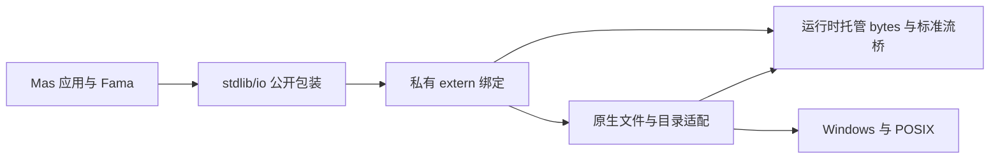

# 应用级同步 IO 技术设计

[需求与验收](requirements.md) · [DeepSeek 实施入口](tasks.md)

## 1. 现状和目标

`stdlib/time` 已有可恢复结果、原生包清单和五目标对象分发。公开 `mas_runtime.h` 提供托管记录分配和字符串复制，未提供字节对象或列表构造 API。现有 `len(string)` 按 Unicode 标量计数，已有严格和可恢复转换。 `print` 使用 Rust stdout 锁并刷新。IO 建立在这些边界上。

## 2. Why / How / What

### 为什么这样设计

流式二进制是大文件、图片、未来 socket 的共同基础。选不可变 `bytes` 加显式文本转换，使同一个缓冲可安全借给原生调用。类型检查可在编译期拦住把文本和字节混用的问题。文件和标准流共用操作接口，具体结果结构沿用 `time`，让调用者能处理失败。关闭资源和错误传播是第一版的组成部分。

### 模块与依赖方向



- 语言通用能力放在 `crates/maslang`，包括 `bytes`、枚举和字符串方法。语言核心不依赖 IO 包，不认识 IO 枚举或结果类型。
- `stdlib/io/src/index.ms` 集中导出 API。按职责分离公开文件、文本和文件系统包装以及私有 extern 声明。原生 C 公共层负责计数、循环、资源状态和错误归并，Windows/POSIX 层负责宿主路径、元数据和独占重命名等差异。按 `time` 的 `settings.toml` 组织包。
- GC 根、对象布局、字节复制和标准流桥属于运行时。常规文件的 OS 资源由原生 IO 包持有。将结果写入已由 Mas 分配并保根的结构，跨分配时确保临时引用仍有效。
- 目录枚举内部采用 open/next/close，Mas 包装收集 `list<string>`。每条路径都关闭迭代器，读到一半失败时返回错误，释放已收集的局部结果。

### 字节语言契约

| 表达式或接口 | 语义 |
| --- | --- |
| `bytes_from_list(values: list<int>) -> bytes?` | 按值复制，元素必须在 0..255 内，有一项越界则返回 null，空列表得到有效空值 |
| `encode_utf8(text: string) -> bytes?` | 合法 UTF-8 原样复制，拒绝原生构造的非法 UTF-8 字符串 |
| `decode_utf8(data: bytes) -> string?` | 严格校验，合法 NUL 保留，失败为 null |
| `len(data)` | 字节数，结果为 int |
| `data[i]` | 读取 0..255 的 int，零基，越界沿用带源码位置的索引运行时错误 |
| `data.slice(start, end) -> bytes?` | 半开区间，复制数据，负数、倒序和超界返回 null |
| `a == b`、`a != b` | 同为 bytes 时逐字节比较 |

以上转换函数为语言内建。允许参数、返回、字段、普通局部和全局、`bytes?` 及 `list<bytes>`。首版禁用索引写入、隐式字符串转换、排序比较和用作 map 键。零长数据使用有效空 bytes 表示。无需新增字面量、`byte` 标量、可写缓冲区或通用切片语法。

实现从现有引用值、字符串字节缓冲和 GC 路径复用适合的部分，保证语义类型独立。新增 C 边界使用独立的 `MasBytes`，字段依次为 `const uint8_t *ptr` 和 `uint64_t len`，配套命名为 `mas_runtime_bytes_clone` 的托管复制入口。支持按引用传结构体时的 bytes 字段，追踪其托管指针偏移。通过结构体字段传递结果，首版无需额外开放顶层 `extern` bytes 参数或返回 ABI。C 不能把栈、临时堆或借入地址挂到托管对象，也不能用 `strlen` 测内容长度。记录新 ABI 支持并保留现有字符串和 time ABI 行为。

### 基础枚举

新增 `enum` 和 `pub enum` 声明。采用冒号及缩进，每行一个成员，值使用 `Type.Member`。支持类型注解、参数、返回、字段、可空值及同类型 `==` 和 `!=`。拒绝空枚举、重复成员、未知成员、跨枚举比较和隐式整数转换。不同模块声明按名义身份区分，支持导入、别名和重导出，模块限定形式沿用现有导入规则。内部可按整数 lowering，序号属于实现细节。按现有规则提供 LSP 类型与成员补全、悬停和诊断。原生出参保留整数错误码，由 Mas 包装显式映射，无需开放 enum 原生 ABI。

```text
pub enum FileMode:
    Read
    Write
    Append
    ReadWrite
```

### 公开 IO API

下列为签名速记，实施时使用实际 Mas 语法。所有入口从 `io` 包导入。表中的 `File` 是传给文件 API 的库句柄。

| 接口 | 返回与行为 |
| --- | --- |
| `open(path: string, mode: FileMode)` | `OpenResult`。Read 要求存在，Write 创建或截断，Append 创建或每次写到末尾，ReadWrite 要求存在且不截断 |
| `stdin()`、`stdout()`、`stderr()` | `File`。返回进程标准流的借用句柄 |
| `read(file: File, count: int)` | `ReadResult`。最多读取 count 字节，正数请求可短读，读到数据时 eof=false，下一次空读取才报告 EOF |
| `read_line(file: File)` | `LineResult`。读至 LF 或文件末尾，剥除 LF 和它前面紧邻的 CR，保留其它字符 |
| `write(file: File, data: bytes)` | `WriteResult`。循环写完整段，失败时返回宿主已接受的字节数 |
| `write_text_to(file: File, text: string)` | `WriteResult`。严格验证 UTF-8 后转到同一写入入口，不添加换行 |
| `flush(file: File)`、`close(file: File)` | `IOStatus`。flush 刷库缓冲。close 即使返回失败也使句柄失效 |
| `seek(file: File, offset: int, origin: SeekFrom)` | `SeekResult`。按 Start、Current、End 计算字节位置，成功返回从开头计数的新位置 |
| `read_file(path: string)`、`read_text(path: string)` | `BytesResult`、`TextResult`。读完整文件，空文件成功 |
| `write_file(path: string, data: bytes)`、`append_file(path: string, data: bytes)` | `WriteResult`。创建或覆盖、创建或追加 |
| `write_text(path: string, text: string)`、`append_text(path: string, text: string)` | `WriteResult`。在打开文件前严格验证 UTF-8 |
| `metadata(path: string)` | `MetadataResult`。跟随符号链接，返回目标类型和普通文件的字节大小 |
| `list_dir(path: string)` | `DirResult`。返回直接子项名称，排除点和双点，顺序未指定 |
| `make_dir(path: string)` | `IOStatus`。创建一级目录，父目录缺失报错，目标已存在报错 |
| `rename(source: string, destination: string)` | `IOStatus`。同一文件系统内移动，目标存在时失败 |
| `remove_file(path: string)`、`remove_dir(path: string)` | `IOStatus`。删除文件或文件符号链接、删除空目录。目录删除拒绝链接及 Windows 目录重解析点 |

#### 结果类型

所有结果都有 `ok: bool`、`code: IOErrorKind`。成功时为 `None`，失败时为下表类别。实现只维护一处宿主错误映射与一处 Mas 枚举映射。

| 类型 | 额外字段 |
| --- | --- |
| `IOStatus` | 无 |
| `OpenResult` | `value: File?`，成功非空 |
| `BytesResult`、`TextResult` | `value: bytes`、`value: string` |
| `ReadResult`、`LineResult` | 相应 `value` 外加 `eof: bool` |
| `WriteResult` | `written: int`，字节数 |
| `SeekResult` | `position: int` |
| `MetadataResult` | `kind: FileKind`（`Regular`、`Directory`、`Other`），`size: int?`，仅普通文件有大小 |
| `DirResult` | `value: list<string>` |

失败时 `eof=false`，引用载荷使用上述可空值或有效空值，位置为 0，元数据为 `Other` 和 null，`written` 保留已接受字节数。二进制 read 遇宿主部分成功时先交付已读字节，将错误保留到下一次正数读取或 read_line。read_line 若在完整行之前遇到读错误，丢弃该次消费的残行并返回错误，完整行仍应交付。整文件读取遇错返回失败和空值。

`IOErrorKind` 成员为 `None`、`NotFound`、`PermissionDenied`、`AlreadyExists`、`InvalidArgument`、`InvalidUtf8`、`Closed`、`WrongMode`、`NotSupported`、`DirectoryNotEmpty`、`TooLarge`、`Other`。成功/失败以 `ok` 为主。公开值独立于 `errno`、Win32 错误号和枚举内部序号。宿主错误应在其他 OS 调用之前捕获。

#### 流与路径边界

- `read(0)` 在句柄和模式有效时返回空值且 eof=false，无宿主读取。负数报 InvalidArgument。越界、溢出和可预期的宿主缓冲分配失败返回错误，禁止负值转无符号形成巨量分配。分块读取按实际需要有界扩容，累计长度和转换均作检查。
- 空行返回成功空串且 eof=false。最后一段无换行的文本作为一行返回。非法 UTF-8 消费该行并报告错误。文本和字节操作共用逻辑位置和缓冲，禁止每次新建独立缓冲读器提前吞掉后续数据。Windows 普通文件使用二进制模式，整文件文本读写原样保留换行。
- Update 模式遵守 C 读写切换要求。写转读需先刷新或定位，读转写需按实际逻辑位置同步底层游标。成功 seek 丢弃旧读缓冲、清除 EOF；遇未报告错误时先返回该错误，再允许重试定位。不要混用独立的系统描述符操作和缓冲流操作。
- `File` 使用进程内受检查的令牌指向原生表项。表项持有模式、文件资源及流状态。Mas 公开类型保留最小封装，先核对记录字段可见性；如果字段可修改，令牌仍按不可信输入验证，不接受裸指针或 OS 描述符。令牌只用于资源生命周期管理，不能当作权限边界。令牌在进程内单调分配、永不复用，溢出报错；无法通过关闭后重开让旧句柄访问新文件。表按开放句柄数量增长，关闭移除条目，表中不留 GC 引用。丢失最后一个 Mas 引用不会自动关闭，进程退出由宿主回收资源，调用方须在结束使用时显式关闭。关闭对全部别名生效，重复关闭报 Closed。表操作在当前同步模型下实现，未来并发 IO 前另行规定同步与竞态。
- 标准流令牌单独保留。stdin 可读，stdout/stderr 可写及 flush，三者的 close/seek 返回 NotSupported。标准输出复用现有 Rust stdout 锁和缓冲，与 print 保持调用顺序。重定向及管道按原始字节处理。Windows 附加控制台受宿主文本限制，合法 UTF-8 文本须可用，无法表示的任意二进制写入返回可恢复错误；禁止把终端行为套到重定向文件。打开包不得擅自修改全进程 CRT 模式。
- 位置、大小和字节计数须完整覆盖有符号 64 位范围内的值；超出返回 TooLarge。Windows 使用宽字符路径 API 及 64 位定位接口。POSIX 路径使用验证后的 UTF-8 字节并附加终止 NUL。拒绝输入路径内嵌 NUL。POSIX 目录遇非法 UTF-8 名称返回 InvalidUtf8，不做损失性替换。
- 删除按宿主的原子删除原语执行。禁止把检查目标不存在再普通 rename 当作独占重命名。各平台使用支持禁止覆盖的原语，宿主或文件系统不支持时返回 NotSupported。跨文件系统移动也返回 NotSupported。
- 整文件接口统一清理。操作失败且关闭也失败时保留首次错误。操作成功但关闭失败时报告关闭错误，保留已接受字节数。普通覆盖可能部分写入。flush 和 close 不承诺断电持久化。

### 字符串方法

| 方法 | 返回及边界 |
| --- | --- |
| `s.split(sep)` | `list<string>`。按字面分隔，保留头尾与连续分隔符产生的空项。空分隔符触发带位置的参数错误，空输入配非空分隔符得到一个空串 |
| `s.index_of(needle)`、`s.index_of(needle, start)` | `int?`。返回首个匹配的 Unicode 标量位置，默认从 0 搜索。找不到或 start 超界返回 null，空 needle 返回合法 start |
| `s.substring(start, end)` | `string?`。半开区间，负数、倒序、超界返回 null |
| `s.to_lower()`、`s.to_upper()` | `string`。使用 Rust 标准库的 Unicode 默认大小写转换，允许长度变化 |
| `s.repeat(count)` | `string?`。负数或无法分配返回 null，零返回空串，先检查长度乘法及分配边界 |

这些方法对原生输入的非法 UTF-8 统一使用带源码位置的语言运行时错误。复用现有字符串方法识别和诊断路径。字符串索引按 Unicode 标量，组合字符可由多个标量组成，禁止把 UTF-8 字节偏移直接返回给 Mas。

## 3. 取舍

- `bytes` 与 `string` 分开，防止非法编码进入文本 API；复用底层所有权实现降低运行时改动。
- 采用具体结果结构，便于先验证文件和未来网络各自的失败形态。泛型和带载荷枚举另立设计，避免用 IO 项目顺手引入类型实例化和模式匹配。
- 文件与目录以 C 宿主适配保留现有预编译包形态，标准流用运行时桥复用 Rust 缓冲。将全部 IO 做成语言内建会扩大核心接口。
- 先显式 close，语义易于检查；GC 自动关闭、`defer` 和可复用可写缓冲等到明确资源模型后再做。

## 4. 实现风险与检查点

- 先验证 bytes 的非空、空值、可空包装、列表元素和 extern 出参在 GC 后仍有效，再接文件。
- 枚举需贯穿模块身份解析和 LSP。若现有语义结构无法支持某个签名，先解决根因并同步文档，禁止用 int 伪装公开枚举。
- 文件错误测试用临时目录、重定向和可控宿主失败。避免依赖管理员权限下不稳定的拒绝访问行为。平台没有真实运行记录时只写“未验证”。
- 原生头文件新增符号后，核对引导运行时导出与预编译包兼容性。已分发的 time 对象按旧契约继续消费。

## 5. 分发方式变更（2026-11-11）

IO 仍以 `stdlib/io` 为唯一维护来源，Mas 包装层、公开签名和原生 ABI 2 不变；变化的只是“怎么到使用者手里”。

- 编译器在构建时把 `stdlib/io` 的 Mas 源码、包清单、C 源与头文件，以及当前目标（`TARGET`）的预编译清单与对象内嵌进二进制。运行时只用这些内嵌资产，不读取仓库路径、工作目录或环境变量。
- 模块层为随附包使用独立于磁盘路径的虚拟根。导入解析以**发出导入的包自己的** `settings.toml` 为准：声明了 `[dependencies].io` 走原规则；未声明时裸 `io` 指向随附包，并优先于同名项目源码；`local.io` 仍解析项目源码。同一模块标识只装载一次，因此多处导入只加入一份原生对象。
- 链接层只在模块图实际使用随附包且要生成可执行程序时，把包按原目录结构写进本次构建的独占工作区，再交给现有原生解析复用版本、目标、ABI 与源码/头文件指纹校验；`--allow-native-source-build` 的刷新结果同样只留在该工作区。
- 同一模块图实际加载随附与显式两套 IO 时，在链接前报冲突，指出显式包根并给出“移除 `[dependencies].io`”或“让所有导入方显式声明同一份依赖”的迁移办法。仅声明但未导入不构成冲突。
- 无项目清单的入口仍只补上随附标准库解析，普通本地模块与第三方包的搜索范围不变。
- Fama 不安装随附 IO、不写 IO 锁项、不创建 `mod_module/io@<version>`；配置了外部编译器时，需要升级到包含本功能的版本，Fama 不为旧二进制代装 IO。
